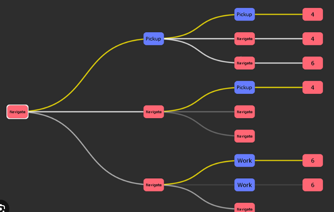

# 任務進程的圖形化節點監控

> Task ID: node-progress-view
>
> 狀態：目標已由使用者確認（2026-10-26），設計是草稿，〈尚未決定〉的題目答完前不實作。
>
> 與其他文件的關係：節點控件由 Web 的 [ProgressTree 計畫](../../Web/Documentation/ProgressTree/plan.md)擁有，它把 TaskProgress 列為第一個宿主，並把關係資料的保存位置、adapter 與典型規模留給宿主的消費計畫決定；本文就是那份消費計畫。Report 的卡片與子項畫面不變，由既有計畫擁有。

## 系統階層與關係

```text
TaskProgress
├─ Report（卡片、子項、checklist）：任務的細節說明，維持不變
├─ 節點監控（本計畫）：全面的進程與阻塞點，以圖形代替文字
│     ↑ adapter：Report 的階層與等待關係 → ProgressTree 的節點、連線與進度
└─ 進度計算：只有一個來源，節點圖沿用 Report 的推算結果
Web ProgressTree：節點、連線、收展、平移縮放（控件，Web 擁有）
```

## 問題與目標

**問題。** 要找出卡住整體進度的地方，現在得在卡片、搜尋列和連結之間來回翻找關係，花的時間長；文字描述越多，越難一眼看出阻塞在哪裡。

**目標（使用者 2026-10-26）。** 每一個任務都以圖形化節點表示。像監控交通一樣，從節點圖直接看出阻塞點，精準處理，而不是在文字裡找關係；盡量減少文字描述。

- 節點監控是**全面**的：看整體進程與阻塞點。
- Report 的卡片與子項是**細節**的：看單一任務的說明與檢查。
- 兩者並存，Report 的進度表繼續存在。

**參考畫面（使用者 2026-10-26）。** 現在沒有任何畫面能一眼看出哪條路線已經可以開始。期望的樣子如下圖：由左往右展開的樹，一眼看出哪裡阻塞、哪裡可以開始，以及各節點的進度狀態。這張圖只示範形式（樹枝方向、連線依狀態上色、可走的路線整條亮起），圖中的標籤與數字屬於原圖，不是本計畫的內容。



**明確非目標。**

- 不取代 Report 的卡片畫面。
- 不在第一階段改變 Report 的資料結構。把資料改成遞迴節點的成本很高，要先估算成本、測試可行，通過才替換（使用者 2026-10-26）。
- 不自己做節點控件；用 Web 的 ProgressTree。

## 現況（2026-10-26）

- **Report 已經是一棵固定深度的樹。** scope → 卡片 → 子項 → checklist → 工作項目 → 檢查，每一層各有不同的型別與欄位；另外由子項的等待宣告形成跨卡片、跨 scope 的依賴關係。
- **進度與狀態都已推算好。** 每個子項的推算狀態（未開始、執行中、等待中、受阻、待他驗、待使用者、需修正、完成、已退場）與等待、受阻原因，CLI 與 Viewer 已能提供。
- **Web ProgressTree 的進度。** 控件與文件 API 的共用切片、節點結構編輯切片已部分實作，尚未發布套件；A → B → C demo 切片還沒完成。它的規劃資料草案把拆解階層（`parentId`）與前置依賴（`requires`）分開，正好對應 Report 的階層與等待關係。
- **載入方式受 UI 替換影響。** TaskProgress 的 Viewer 目前用 Svelte；要在 Viewer 裡直接放 Web 控件，和「TaskProgress UI 改用 Web」那張卡的開始條件相關。

## 設計（草稿）

- **第一階段：投影，不改資料。** 寫一個 adapter，把現有 Report 投影成 ProgressTree 的輸入：卡片是摘要節點、子項是葉節點、等待宣告是前置連線；節點顏色用推算狀態，滑過顯示等待或受阻原因。進度沿用 Report 的計算，不另算一套。
- **阻塞點。** 有其他節點在等、自己卻還沒完成的節點，就是阻塞點；等它的節點越多，越先處理。
- **可開始（ready）。** 尚未完成、不在等任何節點、也沒有人正在做的子項，就是可開始；條件和 TaskProgress 挑「下一步」時相同（[agent-executable-items〈Evaluate a scope〉](../../.agents/skills/agent-executable-items/SKILL.md#evaluate-a-scope)），沿用 Report 推算的等待與執行狀態，不另算。
- **可走的路線。** 從根到每個可開始節點的整條路徑以高亮色畫出，像參考畫面的黃線；不在任何可走路線上的分支不高亮，依自己的狀態著色。看圖的人先看亮起的路線，就知道現在能做什麼。
- **狀態分類。** 節點與連線至少區分四類：可開始、受阻或等待中、進行中、已完成。其餘推算狀態歸到哪一類見〈尚未決定〉。
- **第二階段：評估遞迴節點。** 估算把資料改成「節點可以無限包含節點」的成本（schema、CLI、兩份狀態推算、Viewer、checklist 格式、技能、既有資料轉換），並用資料副本測試轉換是否可行；通過才決定是否替換。

## 尚未決定

1. 顯示範圍：只看單一 scope，還是跨所有 scope（含跨 scope 的等待）。
2. 節點要畫到哪一層：子項為止，或到 checklist 的工作項目。
3. 阻塞點的呈現：除了顏色，是否依等待者數量排序、放大。可走路線整條高亮已定（見〈設計〉）。
4. 入口：在 Report Viewer 裡切換，或獨立的節點頁。
5. 是否需要額外的關係資料：等待宣告已在 report 裡，ProgressTree 計畫建議的關係 sidecar 是否還需要。
6. 第二階段是否把資料改成遞迴節點：等第一階段與成本評估完成後再決定。
7. 葉節點旁的數字顯示什麼：例如完成數／總數、剩餘子項數，或不顯示。
8. 待他驗、待使用者、需修正、已退場這幾種推算狀態，各歸到哪一類狀態、用什麼顏色。
