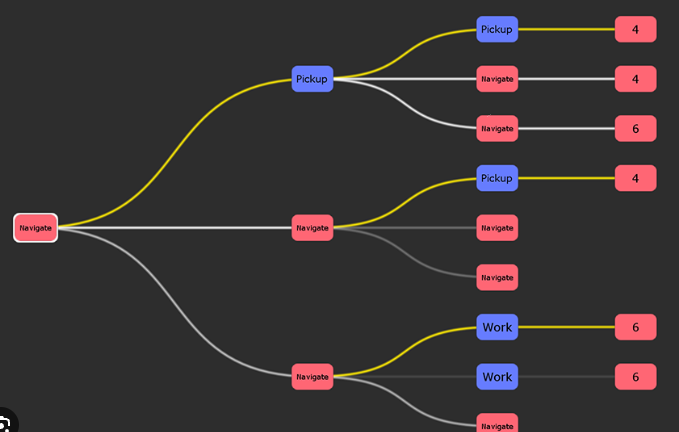

# 任務進程的圖形化節點監控

> Task ID: node-progress-view
>
> 節點圖目標已由使用者確認（2026-10-26），實作前須確認〈尚未決定〉的選擇。同一 scope 的卡片參照匯總、參照鏈與子項升級可獨立實作。
>
> 與其他文件的關係：Web 的 [ProgressTree 計畫](../../Web/Documentation/ProgressTree/plan.md)擁有節點控件。本文擁有 TaskProgress 的節點投影與卡片參照匯總設計。[卡片收合計畫](CardDisclosurePlan.md)擁有 Report 卡片與子項的呈現。

## 系統階層與關係

```text
TaskProgress
├─ Report（卡片、子項、checklist）：任務的細節與進度來源
├─ 節點監控（本計畫）：全面的進程與阻塞點，以圖形代替文字
│     ↑ adapter：Report 的階層與等待關係 → ProgressTree 的節點、連線與進度
└─ 進度計算：只有一個來源，節點圖沿用 Report 的推算結果
Web ProgressTree：節點、連線、收展、平移縮放（控件，Web 擁有）
```

## 問題與目標

**問題。** 要找出卡住整體進度的地方，現在得在卡片、搜尋列和連結之間來回翻找關係，花的時間長；文字描述越多，越難一眼看出阻塞在哪裡。

**目標（使用者 2026-10-26）。** 每一個任務都以圖形化節點表示。像監控交通一樣，從節點圖直接看出阻塞點，精準處理，而不是在文字裡找關係；盡量減少文字描述。

- 節點監控是**全面**的：看整體進程與阻塞點。
- Report 的卡片與子項是**細節**的：看單一任務的說明與檢查。
- 兩者並存，Report 的進度表繼續存在。

**參考畫面（使用者 2026-10-26）。** 現在沒有任何畫面能一眼看出哪條路線已經可以開始。期望的樣子如下圖：由左往右展開的樹，一眼看出哪裡阻塞、哪裡可以開始，以及各節點的進度狀態。這張圖只示範形式（樹枝方向、連線依狀態上色、可走的路線整條亮起），圖中的標籤與數字屬於原圖，不是本計畫的內容。



**明確非目標。**

- 不取代 Report 的卡片畫面。
- 不在第一階段改變 Report 的資料結構。把資料改成遞迴節點的成本很高，要先估算成本、測試可行，通過才替換（使用者 2026-10-26）。
- 不自己做節點控件；用 Web 的 ProgressTree。

## 現況

- **Report 已經是一棵固定深度的樹。** scope → 卡片 → 子項 → checklist → 工作項目 → 檢查，每一層各有不同的型別與欄位；另外由子項的等待宣告形成跨卡片、跨 scope 的依賴關係。
- **進度與狀態都已推算好。** 每個子項的推算狀態（未開始、執行中、等待中、受阻、待他驗、待使用者、需修正、完成、已退場）與等待、受阻原因，CLI 與 Viewer 已能提供。
- **Web ProgressTree 的能力。** [共用控件與結構編輯切片](../../Web/Documentation/ProgressTree/plan.md#共用控件與文件切片)提供兩層節點與相鄰主節點的順序線。規劃草案另有拆解階層與前置依賴，尚須核對正式控件能否表達 Report 的任意等待連線及本計畫選定的顯示深度。
- **正式 Viewer 已採 Web UI Workflow。** 產品頁面由 `ui/web-workflow/` 建置，接入 ProgressTree 仍需固定交付、adapter 和同源驗收。發布基線見 [Web UI 正式接管](WebUiReplacementPlan.md#svelte-退役與-web-ui-workflow-正式接管)。
- **既有引用各有明確用途。** [Report 指路任務卡](../plan.md#report-指路任務卡與單層-scope-導航)指向另一個 scope。`waits_for` 用於表達工作前置條件，目標是子項或 checklist 工作項目。卡片連結只負責導航。目前 Report 子項缺少可投影同 scope 目標卡進度的參照。

## 設計（草稿）

- **第一階段：投影，不改資料。** 寫一個 adapter，把現有 Report 投影成 ProgressTree 的輸入：卡片是摘要節點、子項是葉節點、等待宣告是前置連線；節點顏色用推算狀態，滑過顯示等待或受阻原因。進度沿用 Report 的計算，不另算一套。
- **阻塞點。** 有其他節點在等、自己卻還沒完成的節點，就是阻塞點；等它的節點越多，越先處理。
- **可開始（ready）。** 尚未完成、不在等任何節點、也沒有人正在做的子項，就是可開始；條件和 TaskProgress 挑「下一步」時相同（[agent-executable-items〈Evaluate a scope〉](../../.agents/skills/agent-executable-items/SKILL.md#evaluate-a-scope)），沿用 Report 推算的等待與執行狀態，不另算。
- **可走的路線。** 從根到每個可開始節點的整條路徑以高亮色畫出，像參考畫面的黃線；不在任何可走路線上的分支不高亮，依自己的狀態著色。看圖的人先看亮起的路線，就知道現在能做什麼。
- **狀態分類。** 節點與連線至少區分四類：可開始、受阻或等待中、進行中、已完成。其餘推算狀態歸到哪一類見〈尚未決定〉。
- **第二階段：評估遞迴節點。** 估算把資料改成「節點可以無限包含節點」的成本（schema、CLI、兩份狀態推算、Viewer、checklist 格式、技能、既有資料轉換），並用資料副本測試轉換是否可行；通過才決定是否替換。

## 同一 scope 的卡片參照匯總

以 VCP 的載入速度長期卡為例，展開後可看到各張原任務卡的即時狀態及進度，例如「載入畫面 2／5」，並可直接開啟原卡。目標卡仍擁有它的工作、驗收結果及進度。參照列只儲存自身與目標的穩定 ID，供排序、導航與讀取時投影使用。

參照列連到同 scope 的普通工作卡，允許多層參照，禁止自指、重複目標及循環。缺失或已封存的目標顯示原因，已有參照的舊資料仍可打開並修正。普通工作項的等待與執行規則沿用既有契約。參照列可導航及調整參照，執行、驗收、Next 與工時仍在原工作項。目標卡的狀態、名稱與進度由既有投影讀取，CLI 和 Viewer 對齊，原始資料保持單一來源。

參照列以目標卡名作為可點擊的連結，旁邊顯示該卡的狀態及完成數／總數。點擊沿用 [Report 卡片定位連結](CardPin.md#cli-開啟並釘選)，並把現有子項的到達提示與返回流程擴充到卡片。從參照列到達時，目標卡頭顯示「⮪ 返回來源子項」。每次跳轉只記下當次點擊的來源，讓同一張卡從不同參照列開啟時都能回到正確的子項。來源只存在於當次導覽狀態。

匯總卡的卡頭依引用卡計數。引用兩張卡且其中一張完成時，卡頭顯示 1／2 張卡完成。純匯總卡的完成由目標卡推算，缺失或無效的引用需先修正。有普通工作列的卡片分別呈現自身工作及引用進度，以免混用計數單位。Scope 總進度與工時以原工作卡為計數來源。若節點圖日後顯示參照，adapter 使用同一目標的 ID 與狀態，以關聯指回原節點。 [卡片參照進度決策](/decisions/?scope=task-progress&task=node-progress-view)

驗收用一張長期卡引用兩張普通卡，其中一張另被第二個長期目標引用。修改原卡或重開驗收後，兩處參照顯示一致，scope 總進度及工時仍只計原工作。分別從兩處點擊同一張目標卡，確認 ⮪ 各自回到當次來源子項。直接開啟目標卡的定位連結時，畫面只定位卡片。另驗證舊報告可讀、改名可導航、錯誤引用可修正，以及既有指路與等待行為。預估中型，約 10–16 個 schema、讀寫、畫面與測試檔。可沿用指路卡的唯讀投影思路，需跨 CLI、Viewer 與瀏覽器保存驗證。

## 參照鏈與子項升級

使用者 2026-11-11 決定：任務的深度由參照鏈延伸，不把資料改成遞迴節點，也不拆成每張卡一個檔（理由見 [plan〈任務入口與報告更新規則〉](../plan.md#任務入口與報告更新規則)）。子項長大後可以升級成卡，升級出的卡也能再升級，原本不重要的項目因此能逐步成為大項。

- **參照鏈。** 被引用的卡也可以引用其他卡，一張卡可被多個上層引用。寫入時拒絕形成環的參照；自指、重複目標與指路卡同樣禁止，新增參照的目標須存在且尚未封存。
- **匯總只看直接目標。** 每張卡只匯總它直接引用的卡，依完成張數計。目標本身是純參照卡時，以它推算的狀態計入，不往下重算各層的工作項，所以同一份工作不會被重複計數。Scope 總進度與工時仍只計原工作卡，同一張卡被多處引用也只算一次。
- **子項升級成卡。** Report CLI 提供升級操作：建立新卡，原子項連同 ID、活動紀錄、認領與綁定搬進新卡，成為它的第一個子項；原卡加上參照新卡的參照列。等待原子項的 `waits_for` 自動改指搬家後的位置。升級本身記一筆活動，寫明原卡。
- **呈現。** 頂層清單預設只列根卡，深層的卡由卡片頁一層層進入，見 [卡片收合計畫〈根卡清單與卡片頁〉](CardDisclosurePlan.md#根卡清單與卡片頁)。
- 跨 scope 仍由指路卡處理，不在本設計範圍。

驗收用三層參照鏈：根卡引用兩張卡，其中一張再引用第三張，第三張另被根卡以外的卡引用。核對每層卡頭只計直接目標、scope 總進度不重複計數、寫入形成環時被拒，以及升級後原子項的活動紀錄、認領、綁定與等待都在新卡上延續。

## 尚未決定

1. 顯示範圍：只看單一 scope，還是跨所有 scope（含跨 scope 的等待）。
2. 節點要畫到哪一層：子項為止，或到 checklist 的工作項目。
3. 阻塞點的呈現：除了顏色，是否依等待者數量排序、放大。可走路線整條高亮已定（見〈設計〉）。
4. 入口：在 Report Viewer 裡切換，或獨立的節點頁。
5. 是否需要額外的關係資料：等待宣告已在 report 裡，ProgressTree 計畫建議的關係 sidecar 是否還需要。
6. 第二階段是否把資料改成遞迴節點：已決定不排入，深度改由參照鏈提供（使用者 2026-11-11，見〈參照鏈與子項升級〉）。
7. 葉節點旁的數字顯示什麼：例如完成數／總數、剩餘子項數，或不顯示。
8. 待他驗、待使用者、需修正、已退場這幾種推算狀態，各歸到哪一類狀態、用什麼顏色。
